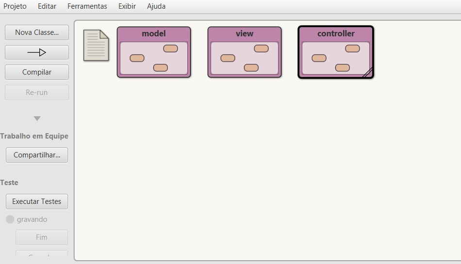
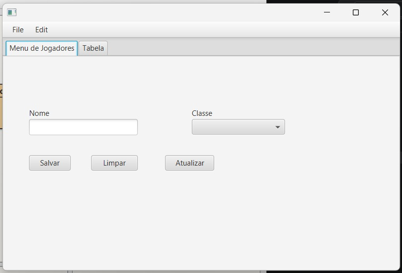
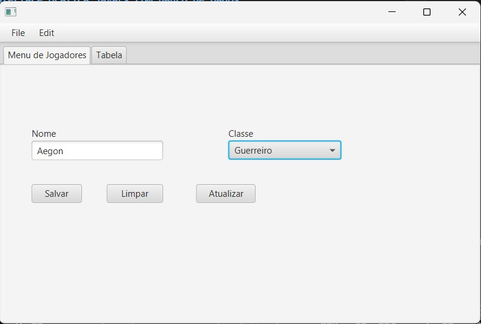
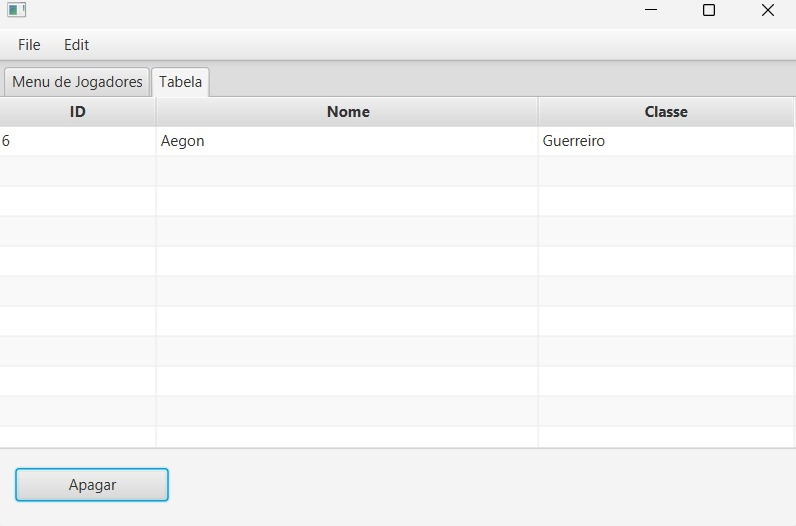
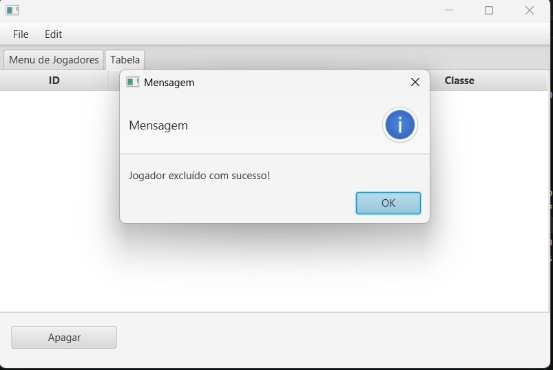
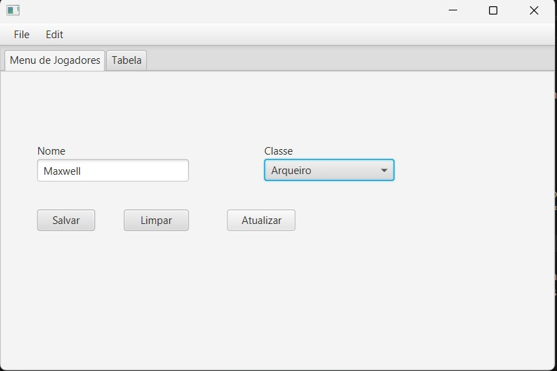
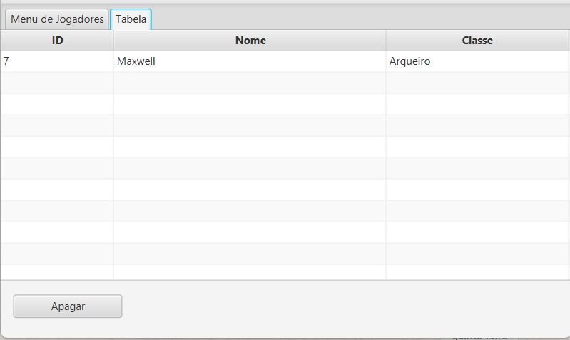

# Interface Gráfica JavaFX com Banco de Dados

 Para este projeto, foi criada uma interface gráfica utilizando **JavaFX**, aplicando os conceitos de arquitetura **MVC** (*Model-View-Controller*) para implementar as funcionalidades **CRUD** (*Create, Retrieve, Update e Delete*).
 Foi desenvolvida uma tela de registro de jogadores que permite cadastrar novos personagens (nome e classe) e armazená-los em um banco de dados por meio de uma camada de persistência (**ORM**). Assim que criado, o jogador é exibido em uma tabela (`TableView`) que conta com ferramentas para atualizar e deletar os registros armazenados.
 O programa foi dividido em **3 pacotes**, seguindo a estrutura MVC, apresentados a seguir:


 
 ## Pacote Model 

 Responsável pelas entidades (`Jogador`), conexão com o banco de dados SQLite (`Database`) e operações de persistência (`JogadorRepositorio`).

 ### Classe Jogador

 ```java
 package model;

import com.j256.ormlite.table.DatabaseTable;
import com.j256.ormlite.field.DatabaseField;
import com.j256.ormlite.field.DataType;

@DatabaseTable(tableName = "jogador")
public class Jogador {

    @DatabaseField(generatedId = true)
    private int id;

    @DatabaseField(dataType = DataType.STRING)
    private String nome;

    @DatabaseField(dataType = DataType.STRING)
    private String classe;

    public Jogador() {
    }

    public int getId() {
        return this.id;
    }

    public void setId(int id) {
        this.id = id;
    }

    public String getNome() {
        return this.nome;
    }

    public void setNome(String nome) {
        this.nome = nome;
    }

    public String getClasse() {
        return this.classe;
    }

    public void setClasse(String classe) {
        this.classe = classe;
    }
}
```
### Classe Database

```java
package model;

import java.sql.*;
import com.j256.ormlite.jdbc.JdbcConnectionSource;

public class Database
{
   private String databaseName = null;
   private JdbcConnectionSource connection = null;
   
   public Database(String databaseName) {
       this.databaseName = databaseName;
   }    
   
   public JdbcConnectionSource getConnection() throws SQLException {
      if ( databaseName == null ) {
          throw new SQLException("database name is null");
      }
      if ( connection == null ) {
          try {
              connection = new JdbcConnectionSource("jdbc:sqlite:"+databaseName);             
            } catch ( Exception e ) {
                System.err.println( e.getClass().getName() + ": " + e.getMessage() );
                System.exit(0);
            }
      }
      return connection;
   }
   
   public void close() {
       if ( connection != null ) {
           try {
               connection.close();
               this.connection = null;
           } catch (java.lang.Exception e) {
               System.err.println(e);
           }
       }
   }
}
```

### Classe JogadorRepositorio

```java
package model;

import com.j256.ormlite.dao.DaoManager;
import com.j256.ormlite.dao.Dao;
import java.sql.SQLException;
import com.j256.ormlite.table.TableUtils;
import java.util.List;
import java.util.ArrayList;

public class JogadorRepositorio
{
    private static Database database;
    private static Dao<Jogador, Integer> dao;
    private List<Jogador> loadedJogadores;
    private Jogador loadedJogador;
    
    public JogadorRepositorio(Database database) {
        JogadorRepositorio.setDatabase(database);
        loadedJogadores = new ArrayList<Jogador>();
    }
    
    public static void setDatabase(Database database) {
        JogadorRepositorio.database = database;
        try {
            dao = DaoManager.createDao(database.getConnection(), Jogador.class);
            TableUtils.createTableIfNotExists(database.getConnection(), Jogador.class);
        }
        catch(SQLException e) {
            System.out.println(e);
        }            
    }
    
    public Jogador create(Jogador jogador) {
        int nrows = 0;
        try {
            nrows = dao.create(jogador);
            if ( nrows == 0 )
                throw new SQLException("Error: object not saved");
            this.loadedJogador = jogador;
            loadedJogadores.add(jogador);
        } catch (SQLException e) {
            System.out.println(e);
        }
        return jogador;
    }    

    public void update(Jogador Jogador) {
      int nrows = 0;
        try {
            nrows = dao.update(Jogador);
            if (nrows == 0)
                throw new SQLException("Error: object not updated");
            this.loadedJogador = Jogador;
        } catch (SQLException e) {
            System.out.println(e);
        }
    }

    public void delete(Jogador Jogador) {
      int nrows = 0;
        try {
            nrows = dao.delete(Jogador);
            if (nrows == 0)
                throw new SQLException("Error: object not deleted");
            this.loadedJogadores.remove(Jogador);
            if (this.loadedJogador != null && this.loadedJogador.equals(Jogador)) {
                this.loadedJogador = null;
            }
        } catch (SQLException e) {
            System.out.println(e);
        }
    }
    
    public Jogador loadFromId(int id) {
        try {
            this.loadedJogador = dao.queryForId(id);
            if (this.loadedJogador != null)
                this.loadedJogadores.add(this.loadedJogador);
        } catch (SQLException e) {
            System.out.println(e);
        }
        return this.loadedJogador;
    }    
    
    public List<Jogador> loadAll() {
        try {
            this.loadedJogadores =  dao.queryForAll();
            if (this.loadedJogadores.size() != 0)
                this.loadedJogador = this.loadedJogadores.get(0);
        } catch (SQLException e) {
            System.out.println(e);
        }
        return this.loadedJogadores;
    }
}
```

## Pacote View

Contém a interface visual construída em FXML (`app.fxml`) e a classe responsável por carregar a janela da aplicação (`AppView`).

### Classe Jogador

```java
package view;

import javafx.beans.property.SimpleIntegerProperty;
import javafx.beans.property.SimpleStringProperty;

public class Jogador {

    private SimpleIntegerProperty id;
    private SimpleStringProperty nome;
    private SimpleStringProperty classe;

    public Jogador(int id, String nome, String classe) {
        this.id = new SimpleIntegerProperty(id);
        this.nome = new SimpleStringProperty(nome);
        this.classe = new SimpleStringProperty(classe);
    }

    public int getId() {
        return this.id.get();
    }

    public void setId(int id) {
        this.id.set(id);
    }

    public String getNome() {
        return this.nome.get();
    }

    public void setNome(String nome) {
        this.nome.set(nome);
    }

    public String getClasse() {
        return this.classe.get();
    }

    public void setClasse(String classe) {
        this.classe.set(classe);
    }
}
```

### Classe AppView

```java
package view;

import javafx.application.Application;
import javafx.fxml.FXMLLoader;
import javafx.scene.Scene;
import javafx.scene.layout.Pane;
import javafx.stage.Stage;
import java.io.File;
import java.net.URL;


public class AppView extends Application
{
    private FXMLLoader loader;
    private URL url;
    private Stage primaryStage;
    
    public AppView() {
        this.loader = new FXMLLoader();
        try {
            this.url = new File("view/app.fxml").toURI().toURL();
        } catch (Exception e) {
            System.out.println("Erro na carga do FXML:" + e);
        }
        this.loader.setLocation(this.url);        
    }
    
    @Override
    public void start(Stage primaryStage) throws Exception {
        try {
            Pane pane = loader.<Pane>load();
            Scene scene = new Scene(pane);
            this.primaryStage = primaryStage;
            primaryStage.setScene(scene);
            primaryStage.show();            
        } catch (Exception e) {
            e.printStackTrace();
        }
    }
    
    @Override
    public void stop() {
        System.exit(0);
    }
    
    public void run(String[] args) {
        Application.launch(args);
    }
}
```

## Pacote Controller

Gerencia a interação do usuário com a tela, conectando os botões e campos da interface às operações do banco de dados (`AppController`).

### Classe AppController

```java 
package controller;

import javafx.fxml.FXML;
import javafx.fxml.Initializable;
import javafx.scene.control.Alert;
import javafx.scene.control.Alert.AlertType;
import javafx.scene.control.Button;
import javafx.scene.control.ChoiceBox;
import javafx.scene.control.TableColumn;
import javafx.scene.control.TableView;
import javafx.scene.control.TextField;
import javafx.scene.control.cell.PropertyValueFactory;
import javafx.collections.FXCollections;
import javafx.collections.ObservableList;

import java.net.URL;
import java.util.List;
import java.util.ResourceBundle;

import model.Database;
import model.JogadorRepositorio;
import view.AppView;

public class AppController implements Initializable {

    @FXML
    private TableView<model.Jogador> tabela;
    @FXML
    private TableColumn<model.Jogador, Integer> idCol;
    @FXML
    private TableColumn<model.Jogador, String> nomeCol;
    @FXML
    private TableColumn<model.Jogador, String> classeCol;

    @FXML
    private TextField nomeField;
    @FXML
    private ChoiceBox<String> classeChoiceBox;
     @FXML
     
    private Button excluirButton;
    @FXML
    private Button atualizarButton;
    @FXML
    private Button salvarButton;
    @FXML
    private Button limparButton;

    AppView appView;

    private static Database database = new Database("app.sqlite");
    private static JogadorRepositorio jogadorRepo = new JogadorRepositorio(database);

    public AppController() {
        this.appView = new AppView();
    }

    public static void main(String[] args) throws Exception {
        AppController appController = new AppController();
        appController.appView.run(args);
    }

    @Override
    public void initialize(URL location, ResourceBundle resources) {
        classeChoiceBox.getItems().addAll("Guerreiro", "Mago", "Arqueiro");
        
        tabela.getSelectionModel().selectedItemProperty().addListener(
        (observableValue, oldSelection, newSelection) -> {
            if (newSelection != null) {
                nomeField.setText(newSelection.getNome());
                classeChoiceBox.setValue(newSelection.getClasse());
            }
        }
    );
        idCol.setCellValueFactory(new PropertyValueFactory<>("id"));
        nomeCol.setCellValueFactory(new PropertyValueFactory<>("nome"));
        classeCol.setCellValueFactory(new PropertyValueFactory<>("classe"));

        tabela.setItems(loadAllJogadores());
    }
    
    @FXML
    public void onAtualizarButtonAction() {
        model.Jogador jogadorSelecionado = tabela.getSelectionModel().getSelectedItem();

        if (jogadorSelecionado == null) {
            new Alert(AlertType.WARNING, "Selecione um jogador na aba Tabela para atualizar!").show();
            return;
        }

        String nome = nomeField.getText().trim();
        String classe = classeChoiceBox.getValue();

        if (nome.isEmpty() || classe == null) {
            new Alert(AlertType.WARNING, "Preencha o nome e escolha uma classe!").show();
            return;
        }

        try {
            jogadorSelecionado.setNome(nome);
            jogadorSelecionado.setClasse(classe);

            jogadorRepo.update(jogadorSelecionado);
            tabela.refresh();

            onLimparButtonAction();
            tabela.getSelectionModel().clearSelection();
            new Alert(AlertType.INFORMATION, "Jogador atualizado com sucesso!").show();
        } catch (Exception e) {
            new Alert(AlertType.ERROR, "Erro ao atualizar: " + e.getMessage()).show();
        }
    }
    
    @FXML
    public void onExcluirButtonAction() {
        model.Jogador jogadorSelecionado = tabela.getSelectionModel().getSelectedItem();

        if (jogadorSelecionado == null) {
            new Alert(AlertType.WARNING, "Selecione um jogador na tabela para excluir!").show();
            return;
        }

        try {
            jogadorRepo.delete(jogadorSelecionado);
            tabela.getItems().remove(jogadorSelecionado);
            new Alert(AlertType.INFORMATION, "Jogador excluído com sucesso!").show();
        } catch (Exception e) {
            new Alert(AlertType.ERROR, "Erro ao excluir: " + e.getMessage()).show();
        }
    }
    
    @FXML
    public void onSalvarButtonAction() {
        try {
            String nome = nomeField.getText().trim();
            String classe = classeChoiceBox.getValue();

            if (nome.isEmpty() || classe == null) {
                new Alert(AlertType.WARNING, "Preencha o nome e escolha uma classe!").show();
                return;
            }

            model.Jogador jogador = new model.Jogador();
            jogador.setNome(nome);
            jogador.setClasse(classe);

            model.Jogador jogadorSalvo = jogadorRepo.create(jogador);
            tabela.getItems().add(jogadorSalvo);

            onLimparButtonAction();
            new Alert(AlertType.INFORMATION, "Jogador salvo com sucesso!").show();
        } catch (Exception e) {
            new Alert(AlertType.ERROR, "Erro ao salvar: " + e.getMessage()).show();
        }
    }

    @FXML
    public void onLimparButtonAction() {
        nomeField.setText("");
        classeChoiceBox.setValue(null);
    }

    private ObservableList<model.Jogador> loadAllJogadores() {
        ObservableList<model.Jogador> lista = FXCollections.observableArrayList();
        List<model.Jogador> listaFromDatabase = jogadorRepo.loadAll();
        lista.addAll(listaFromDatabase);
        return lista;
    }
}
```

## Executando a Aplicação JavaFX

  Neste tópico veremos uma demonstração da aplicação criada. O sistema conta com duas abas superiores dedicadas à **criação de um novo jogador** e à **visualização da tabela** contendo os jogadores cadastrados.

  ### Menu de Criação de Jogadores

  O menu de criação de jogadores contém dois campos: um **campo de texto** para definição do nome do jogador e uma **caixa de escolha** que permite selecionar uma entre três classes: **Mago**, **Guerreiro** ou **Arqueiro**. Além disso, possui os botões **Salvar**, **Limpar** e **Atualizar**.

  

  ### Criando um novo Jogador

 Após digitar um nome e selecionar a classe desejada, basta clicar no botão **Salvar** e o jogador será armazenado na tabela.



Em seguida, ao selecionar a aba **Tabela**, será possível visualizar a listagem com o novo jogador criado.



### Funcionalidades da Tabela (Visualização, Atualização e Exclusão)

Na tela da aba **Tabela**, é possível visualizar todos os jogadores salvos e utilizar o botão **Deletar**. Para remover um registro, basta selecionar o jogador desejado na tabela e pressionar o botão **Deletar**.



Caso o objetivo seja alterar os dados de um jogador existente, basta selecioná-lo na tabela e retornar à aba **Menu de Jogadores**, onde seus dados já estarão preenchidos. Em seguida, basta editar os campos desejados e pressionar o botão **Atualizar**.




